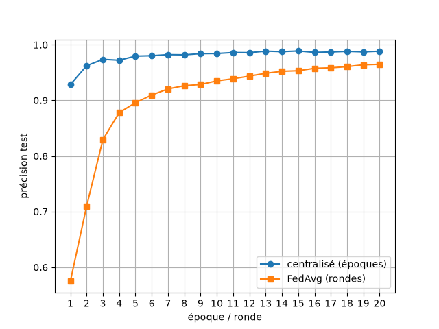

# fedavg-mnist

FedAvg (Federated Averaging) implemented from scratch in PyTorch and tested on MNIST, with a model watermarking experiment to protect model ownership.


The training data is split across 10 simulated clients. Each round, every client trains a copy of the global model on its own data, sends back only its weights, and the server averages them. No data leaves a client.

## Setup

- Model: small CNN (2 conv layers + 2 dense layers, ~207k parameters)
- 10 clients, IID split (6,000 images each)
- SGD, lr 0.01, batch size 32, CPU only
- Accuracy measured on the 10,000 MNIST test images

## Results

**Centralized vs FedAvg** (one round = each image seen once, same as one epoch)

| | After 1 | After 20 |
|---|---|---|
| Centralized (epochs) | 92.85% | 98.85% |
| FedAvg (rounds) | 57.46% | 96.50% |



**Local epochs per round** (10 rounds, all clients)

| Local epochs | Final accuracy |
|---|---|
| 1 | 93.63% |
| 2 | 96.46% |
| 5 | 98.13% |

**Fraction of clients per round** (10 rounds, 1 local epoch)

| Fraction | Final accuracy |
|---|---|
| 0.1 | 93.36% |
| 0.5 | 93.62% |
| 1.0 | 93.63% |

More local epochs reach higher accuracy in fewer rounds. With IID data, using only part of the clients per round gives almost the same final accuracy. Each configuration was run once (seed 0).

## Model watermarking

A trigger-set watermark is embedded in the CNN to prove model ownership: 100 random noise images with random labels act as a secret key. A watermarked model recognizes them, a clean model answers at chance level. The watermark is then tested against transformations needed for microcontroller deployment.

| Model | Test accuracy | Watermark accuracy |
|---|---|---|
| Clean (no watermark) | 98.17% | 12% |
| Watermarked | 98.65% | 98% |
| Watermarked + int8 quantization | 98.69% | 98% |
| Watermarked + 50% pruning | 98.69% | 93% |
| Watermarked + fine-tuning (1 epoch, 10k images) | 98.89% | 100% |

The watermark adds no accuracy loss and survives int8 quantization and 50% pruning. The fine-tuning attack used here is light; a stronger attack would be the next step to test. Trained centrally, 3 epochs, seed 0.

## Project structure

```
src/        data split, model, local training, FedAvg, evaluation, watermarking
notebooks/  01 data exploration, 02 centralized baseline, 03 FedAvg, 04 experiments, 05 watermarking
results/    figures and accuracies (JSON)
```

## How to run

```
pip install -r requirements.txt
```

Then run the notebooks in order from the `notebooks/` folder. MNIST is downloaded automatically into `data/`.